# The presentation guide (and a refresher on the whole project)

This guide has two jobs:
1. **Presentation:** every slide, with a screenshot, what each word on it means, what to say, what to be careful about, and the questions you might get.
2. **Project refresher:** everything we've done so far, every decision and why, the plans, the architecture and the vocabulary. If you read only one document before the board, read this one.

The screenshots are of the deck as it stood on 2026-11-06 (13 slides). Link to the deck: https://claude.ai/artifact/N6e6SsWzupuPcMasPJ46eX.

How it's organised:

```
 PART 1  The project on one page (the mind map)
 PART 2  The story so far: everything we did, in order, and why
 PART 3  Every decision we took (decision log)
 PART 4  Concepts and vocabulary (remote sensing, GIS, ML, software)
 PART 5  The slides, one by one (screenshot · words · script · cautions · questions)
 PART 6  The architecture and plans in depth (modules A, B, C, Phase R, Pakistan)
 PART 7  Question bank, with answers
 PART 8  Honest weaknesses, and how to talk about them
 PART 9  Numbers cheat-sheet
 PART 10 Before you present: checklist
```

---

# PART 1: The project on one page

## 1.1 In one sentence

> AgriMon is a web map that shows, **for each field**, whether it is **sugarcane**, how **healthy** it is over time, and an **indicative yield**, built from **free satellite images**. It's developed first on open US data (Louisiana) and then adapted to Pakistan.

## 1.2 The mind map

```
                                   AGRIMON
                                      │
     ┌──────────────┬─────────────────┼──────────────────┬──────────────────┐
     │              │                 │                  │                  │
   WHY            WHAT              DATA               HOW               WHERE NOW
     │              │                 │                  │                  │
 Pakistan:      the app: a        Stage 1: US        Phase R first      Phase R
 1.22 M ha      web map           (Louisiana)        (research,         (research and
 cane; mills    showing ...        ├ CSB: fields     spikes, then       architecture),
 need field-     ├ P-1 field       ├ CDL: crop       architecture       spikes S01 + S02
 level info      │   polygons      │   labels        approval)          done, deck
                 ├ P-2 crop type   ├ Sentinel-2:     then modules       ready
 no practical    │  (cane or not)  │   imagery       A → B → C
 Pakistani       ├ P-3 health      ├ NASS: yield     iterative,         next:
 dataset with    │   per field     │   statistics    phase-gated        S03 Sentinel-2
 field           └ P-4 yield       │                 GitHub workflow    S04 yields
 boundaries                        Stage 2:          every choice       literature
                                   Pakistan          backed by          Checkpoint R
                                   (SUPARCO asked;   evidence
                                   else: pipeline +
                                   Pakistani models +
                                   draw field
                                   boundaries)
```

## 1.3 The two stages

```
 STAGE 1 (now)                                  STAGE 2 (end of the FYP)
 build and prove the full app where             adapt to Pakistan with the data
 open data is rich: Louisiana, USA              that exists there
 ─────────────────────────────────              ─────────────────────────────────
 fields + labels + imagery + yields  ──────►    if SUPARCO gives field boundaries:
 all available and free                         build the Pakistan version on them
                                                if not: the US pipeline + models
                                                built for Pakistani conditions +
                                                (if possible) drawing field
                                                boundaries from satellite images
```

**Why this order, in your own words:** "I can't build and test a field-level system without field boundaries and labels. Pakistan doesn't have an open dataset with field boundaries, so I build and prove the whole pipeline where one exists, then carry it to Pakistan."

## 1.4 The four things the app shows (the product spec, P-1 to P-4)

| Code | Capability | Your words (2026-10-27) | Priority |
|---|---|---|---|
| P-1 | Field polygons on a map | "properly mapped polygons of fields" | must |
| P-2 | Crop type per field, preferably sugarcane vs non-sugarcane | "showing which crop they are" | must |
| P-3 | A health layer per field | "a health layer on top of each field" | must |
| P-4 | Yield estimate | "and then a yield estimation" | decided once we know what yield data exists |

Source: `docs/architecture/product_spec.md`.

---

# PART 2: The story so far (everything we did, in order, and why)

## 2.1 Timeline

| When | What happened | Why it mattered |
|---|---|---|
| Aug–Oct 2026 | Form 1A submitted (title, supervisor, two-phase idea, Rahim Yar Khan motivation) | The official proposal the board knows |
| 2026-10-10 (sessions 1–2) | The "kit" was set up: repository, rules (`CLAUDE.md`), protocols, GitHub workflow, CI, hooks; first practice run of the workflow | A professional base: everything is tracked, reviewable and reproducible |
| 2026-10-27 (session 3) | **Kit audit:** checked everything the kit had pre-planned against the bigger goal | The kit was planned from one module and one dataset, not from the final app. We re-planned from the product |
| 2026-10-27 | **Product spec** written from your answers (P-1 to P-4) | Every later choice (data, design) is now judged against what the app must show |
| 2026-10-27 | **Dataset search, round 1:** four candidate "stacks" compared | You chose the **US stack (CSB + CDL)** and **Louisiana** |
| 2026-10-27 | CDL sugarcane accuracy checked in NASS metadata (about 94–96 %) | Evidence that the US labels can be trusted for sugarcane |
| 2026-10-27 | Related work on Louisiana found (Di Tommaso 2024, Hu 2022, NASS hurricane report, etc.) | Shows the pieces exist separately; nobody combines them |
| 2026-10-27 | Briefing B01 (the whole picture) written | Your own catch-up document |
| 2026-10-27/28 | Environment set up (Miniforge, conda env `agrimon-spikes`); national CSB downloaded (3.76 GB); **Spike S01** | First real data: Louisiana fields explored, Iberia parish chosen, all 3 checks passed |
| 2026-10-28 | Briefing B02 (S01 explained line by line) | So you can explain the code and statistics yourself |
| 2026-11-04 | Presentation guidelines read; work estimated (~4 days); literature/existing-systems review drafted | Slides 3 and 5 got their evidence |
| 2026-11-04 | Earth Engine Python package installed; you logged in | Matches "cloud GEE and Python GEE envs setup" on your attendance sheet (project link still pending) |
| 2026-11-06 | CDL 2023 downloaded (2.06 GB); **Spike S02** | Label purity checked: typical cane field is 95 % cane, 100 % one pixel in from the edge |
| 2026-11-06 | Requirements and diagrams drafted; Briefing B03 (why CSB and CDL); slide notes; the deck built and refined with you | Ready for the presentation |
| 2026-11-06 | You stated the Stage 2 plan (SUPARCO contacted; fallback contributions) | Recorded in `product_spec.md` section 6 and on slide 7 |

## 2.2 What exists in the repository (your evidence trail)

```
 agrimon/
 ├── CLAUDE.md                      the project's rules (always on)
 ├── environment-spikes.yml         the Python environment (+ .lock.txt with exact versions)
 ├── notebooks/exploration/         throwaway spike notebooks
 │   ├── 01_csb_fields.ipynb        S01
 │   ├── 02_cdl_labels.ipynb        S02
 │   └── make_slide_figures.py      the slide charts
 ├── data/  (NOT in git)            raw/csb, raw/cdl, interim/, reference/
 └── docs/  (your Obsidian vault)
     ├── STATUS.md, HANDOFF.md       where we are; how to resume
     ├── briefings/  B01 B02 B03     catch-up documents for you
     ├── architecture/               kit_audit, product_spec, design_questions,
     │                               hypothesis_register, presentation_diagrams
     ├── requirements/               requirements_register (aim, objectives, FR, NFR)
     ├── research/                   dataset_catalogue, related_work_louisiana,
     │                               existing_systems_review, search_log,
     │                               datasets/ (CSB, CDL notes), spikes/ (S01, S02 + figures)
     └── presentation/               slide notes, this guide, figures, slide screenshots
```

## 2.3 How we work (the rules behind everything)

| Rule | Plain meaning | Why |
|---|---|---|
| **Phase R before building** | Research the design questions, run small experiments, get the architecture approved (Checkpoint R), then build | Every design choice must have evidence you can defend |
| **The repository is the memory** | Anything important is written in repo files, not left in chats | Any session or machine can pick up where we left off |
| **Never invent facts** | No number, link, citation or licence without checking the source | A single wrong fact in the viva undermines everything |
| **Pass rules before looking** | Each spike states its success rule before seeing results | Stops us from fooling ourselves (like writing the test before the code) |
| **Observation separate from interpretation** | "What we saw" and "what we think it means" are written separately | Honest science; the board can disagree with the interpretation but not the observation |
| **Git workflow** | Issue → branch → commits → draft pull request → checks → you merge | Reviewable history; nothing goes to `main` without you |
| **You must understand everything** | If you can't explain a part, it isn't finished | The university allows AI use but requires understanding |

---

# PART 3: Every decision we took (decision log)

| # | Decision | Date | Options considered | Why this one | What would change it |
|---|---|---|---|---|---|
| D1 | Two stages: open data first, then Pakistan | 2026-10-10 | Pakistan only; open data only | Pakistan lacks open field-level data; learning the full stack first makes Stage 2 cheaper and better | Pakistani field-boundary data becomes available early |
| D2 | Plan from the product, not from a dataset | 2026-10-27 | Keep the kit's module-first plan | The app must show P-1 to P-4, so data must support all four | – |
| D3 | **US stack: CSB (fields) + CDL (labels)** | 2026-10-27 | La Réunion, Brazil-Crop, EuroCrops/France | Only one we could verify covers every need; public domain; 18 seasons with sugarcane | CDL accuracy turning out much worse than reported |
| D4 | **Louisiana** (study parish: **Iberia**) | 2026-10-27/28 | Florida; other parishes | Most cane fields of any US state (32,373 in 2023); cane next to other crops (soybeans, rice, corn); documented hurricanes and freezes; Iberia has the most cane fields of any parish | A more mixed parish needed for a fair test (planned: maybe Pointe Coupee or St. Landry as a second area) |
| D5 | Spikes before models | 2026-10-27 | Start building the pipeline now | Rule 0: no building before Checkpoint R; spikes give evidence cheaply | – |
| D6 | conda-forge (Miniforge) environment | 2026-10-27 | uv/pip | GDAL, PROJ and GEOS must match; conda installs them together | – |
| D7 | Jupyter notebooks for spikes | 2026-10-27 | Scripts + figures | Teaching: run cell by cell, see outputs | – |
| D8 | No disk budget limit; keep downloads | 2026-10-27 (you) | Delete after clipping | Plenty of space; re-downloading costs time | – |
| D9 | CSB adopted (provisionally) for Iberia | 2026-10-28 (S01) | – | Passed all 3 pass rules | Final at Checkpoint R (ADR) |
| D10 | CSB labels adopted (provisionally) as training labels, with an inner buffer before extracting pixels | 2026-11-06 (S02) | Use as is; purity filter | Impure pixels are mostly at edges; shrinking fields one pixel makes them pure | Purity much worse in other years/parishes |
| D11 | Development method: iterative, phase-gated (Agile style) | 2026-11-06 | Waterfall | Data and methods are uncertain; S01 already changed the plan | – |
| D12 | Storage: GeoParquet files (+ DuckDB), no database server | 2026-11-06 (proposed) | PostgreSQL/PostGIS | Per-field tables are small; files are reproducible; nothing to administer | A multi-user live app (Stage 2/startup) would need a server |
| D13 | Planetary Computer as default imagery; Earth Engine optional, behind an interface | proposed | GEE only | GEE free tier is noncommercial; open STAC keeps future options open | – |
| D14 | Stage 2 plan: SUPARCO contacted; fallback = US pipeline + Pakistani models + field-boundary drawing | 2026-11-06 (you) | – | No practical Pakistani dataset with field boundaries | SUPARCO's answer |
| D15 | Presentation: "No" for unconfirmed matrix cells (except EuroCrops licence, verified CC BY 4.0) | 2026-11-06 (you) | "Not verified" | Your choice for a cleaner slide; the notes keep the honest meaning | – |

**Still open (not decided yet):**
- Binary (cane vs non-cane) or multi-class? (DQ-14, H-19)
- Is Sentinel-1 radar needed? (DQ-03)
- Do parish-level yields exist? (DQ-22, S04)
- The final model choices (DQ-13).
- The code licence (MIT or Apache-2.0).

---

# PART 4: Concepts and vocabulary

Plain words first, then the detail.

## 4.1 Remote sensing (seeing the Earth from satellites)

| Term | Plain meaning | Detail you may need |
|---|---|---|
| **Remote sensing** | Measuring things from a distance, here from satellites | The satellite measures how much sunlight each patch of ground reflects, in different colours (wavelengths) |
| **Sentinel-2** | A European (ESA, Copernicus programme) satellite mission that photographs all land every few days, free | 13 spectral bands; pixel sizes 10, 20 or 60 m depending on the band; revisit about every 5 days (the constellation changed recently with Sentinel-2C, so check before quoting an exact figure) |
| **Band** | One colour channel of an image (like R, G, B in a photo, but more of them) | Includes visible light, red-edge, near-infrared (NIR) and short-wave infrared (SWIR) |
| **Near-infrared (NIR)** | Light just beyond red that our eyes can't see | Healthy leaves reflect a lot of NIR; stressed or sparse plants reflect less |
| **Red-edge** | The narrow zone between red and NIR | Sensitive to chlorophyll; useful for early stress |
| **SWIR** | Short-wave infrared | Sensitive to water in leaves and soil |
| **Reflectance** | The fraction of light reflected (0 to 1) | "L2A" products give surface reflectance, corrected for the atmosphere |
| **L2A** | Sentinel-2 "Level-2A": surface reflectance, atmosphere-corrected, with a scene classification layer | The product we use |
| **NDVI** | A greenness index: how much living vegetation is there | NDVI = (NIR − Red) / (NIR + Red), between −1 and 1. Example: NIR 0.5, Red 0.1 → (0.4)/(0.6) = 0.67, a healthy crop. Bare soil is about 0.1–0.2 |
| **Vegetation index** | A formula combining bands to highlight plants | NDVI, NDRE (red-edge), NDMI (moisture) … |
| **Time series** | The same measurement over many dates | A field's NDVI through the season draws a growth curve |
| **Cloud mask / SCL** | Marking cloudy pixels so they're ignored | SCL is Sentinel-2's Scene Classification Layer (cloud, shadow, water, vegetation …) |
| **Sentinel-1 (radar)** | A radar satellite that sees through clouds | Useful in monsoon or cloudy seasons; decided later (DQ-03) |
| **Landsat** | A US satellite series (30 m) | One of the CDL's inputs |
| **MODIS** | A coarse (250 m–1 km) daily satellite sensor | Used in older yield studies (Hu 2022) |
| **GEDI** | A lidar on the space station that measures plant height | Used by Di Tommaso 2024 to find tall crops like cane |
| **Resolution** | Pixel size on the ground | 10 m: one pixel = 10 × 10 m = 100 m² = 0.01 ha |
| **Ground truth** | What is really on the ground, checked by people | We have none of our own; our labels come from USDA |

## 4.2 GIS (maps and geodata)

| Term | Plain meaning | Detail |
|---|---|---|
| **Vector data** | Shapes made of coordinates: points, lines, polygons | Our fields (CSB) are vector polygons, each with attributes |
| **Raster data** | A grid of pixels, each with a value | CDL and Sentinel-2 are rasters |
| **Polygon / MultiPolygon** | A closed shape; MultiPolygon = several pieces counted as one feature | A field split by a ditch is one MultiPolygon |
| **Attribute table** | The table of facts attached to each shape | CSB: field id, acres, crop per year, county … |
| **CRS** | Coordinate reference system: what coordinate numbers mean | The same corner was `(312592.9, 929571.7)` in Albers metres and `(-92.70035, 31.39261)` in degrees |
| **EPSG code** | A standard id for a CRS | 4326 = longitude/latitude; 32615 = UTM zone 15N (Sentinel-2 in Louisiana) |
| **Equal-area projection (Albers)** | A flat map where areas stay correct | Why CSB areas are trustworthy |
| **Zonal statistics** | Summarising the pixels inside each polygon | How we got "share of cane pixels per field" in S02 |
| **Rasterize** | Burning polygons into a pixel grid | Step 1 of zonal statistics |
| **Buffer (negative / inner)** | Shrinking a shape inward by a distance | −30 m removed edge pixels in S02 |
| **GeoParquet** | A fast, compressed table file that keeps geometry and CRS | Louisiana: 88 MB, loads in seconds |
| **File Geodatabase (.gdb)** | Esri's GIS format | How NASS ships the CSB |
| **FIPS** | US codes for states and counties | 22 = Louisiana |
| **Parish** | Louisiana's word for a county | Iberia, Pointe Coupee … |
| **STAC** | A standard catalogue format for satellite images | Lets code search "Sentinel-2 over this area, these dates" |
| **Web map tiles / PMTiles** | Map data cut into small pieces for fast display | PMTiles = one file of tiles, no server needed |

## 4.3 The datasets

| Dataset | What it is | Made how | Key facts |
|---|---|---|---|
| **CDL** (Cropland Data Layer) | A US crop map, 30 m, every year | A USDA classifier trained on farmer-reported FSA data, using Landsat **and Sentinel-2** | Code 45 = sugarcane. Louisiana sugarcane accuracy: producer's 94.1–95.0 %, user's 95.8–96.4 % (2020, 2022, 2023). Public domain |
| **CSB** (Crop Sequence Boundaries) | US field polygons with 8 years of crop history | An algorithm groups CDL pixels with the same 8-year crop sequence into polygons; no manual drawing; small polygons merged; outlines smoothed (60 m) | Edition 2018–2025: 15,973,095 fields; Louisiana 206,389; Iberia 5,632 (4,213 cane in 2023). Public domain |
| **FSA / CLU** | Farmers' own crop reports to the US Farm Service Agency | Declarations | Confidential; the closest thing to ground truth; used to train and test the CDL |
| **NASS Quick Stats** | US agricultural statistics | Surveys | State-level sugarcane yields confirmed; parish level still to check (S04) |
| **Brazil-Crop** | 5,477 Brazilian fields, 30 classes incl. sugarcane, ground survey | Field campaigns 2020–21 | Only 2 seasons per region; no recent fields |
| **EuroCrops** | Harmonised EU farmer declarations | Declarations | CC BY 4.0; France 2015–2023; **no sugarcane** |
| **La Réunion RPG** | French parcel register for the island | Farmer declarations | Sugarcane is the main crop; open access at parcel level not confirmed |
| **Pakistan Zenodo record 22806700** | 85,618 fields' time series, 79 districts, CC BY 4.0 | – | **No field polygons mentioned**; a Stage 2 lead |

## 4.4 Accuracy and statistics

| Term | Plain meaning | Example |
|---|---|---|
| **Producer's accuracy** (= recall) | Of the real cane, how much did the map find? | 95 % means it missed 5 % of real cane |
| **User's accuracy** (= precision) | Of what the map calls cane, how much is really cane? | 96 % means 4 % of "cane" pixels are something else |
| **Recall / precision / F1** | Same ideas in ML language; F1 balances both | F1 = 2·P·R/(P+R). Di Tommaso Pakistan: recall 0.43, F1 0.6 |
| **Overall accuracy** | Share of all pixels classified correctly | Can hide poor results on small classes |
| **Median** | The middle value | Field sizes 2, 3, 4, 5, 100 → median 4 (mean 22.8, pulled up by the giant) |
| **Percentile** | Value below which p % of data falls | 10th percentile of cane field size = 1.97 ha |
| **Held-out test** | Testing on data the model never saw in training | Train on some years, test on another year |
| **Spatial autocorrelation** | Nearby things are similar | Random splits put neighbouring fields in train and test, so scores look too good. That's why we hold out areas |
| **Circularity** | Training on labels made by a similar model on similar data | The CDL uses Sentinel-2; our model learns to copy it in part |
| **Baseline** | The simplest reasonable method to beat | Majority class, an NDVI threshold, LightGBM |

## 4.5 Machine learning models (planned, not yet built)

| Model | Plain meaning | Why it's on our list |
|---|---|---|
| **LightGBM** | Gradient-boosted decision trees: many small trees, each fixing the last one's mistakes | Fast, strong on tables (e.g. per-field band statistics); the baseline |
| **TempCNN** | A convolutional neural network that slides along the time axis | A standard deep model for crop time series (Pelletier 2019) |
| **Attention / Transformer models** | Models that learn which dates matter most | State of the art for satellite time series (Garnot 2020) |
| **Calibration** | Making "90 % confident" really mean right 90 % of the time | So confidence on the map is honest |
| **Anomaly / deviation** | How far a field's curve is from what's expected | The core of the health layer (H-06) |

## 4.6 Sugarcane agronomy

| Term | Meaning |
|---|---|
| **Semi-perennial** | Planted once, then harvested for several years without replanting |
| **Plant cane** | The first crop after planting |
| **Ratoon** | Regrowth from the stubble after harvest (1st, 2nd, 3rd ratoon …) |
| **Fallow** | A field left unplanted for a season, usually before replanting |
| **Cane cycle in Louisiana (from S01)** | Usually 3–4 cane years, one fallow (or soybean) year, then replanting |
| **Lodging** | Cane falling over (wind, hurricanes) |

## 4.7 Software and tools

| Tool | Plain meaning | Our use |
|---|---|---|
| **Python 3.12** | The programming language | Everything in the pipeline |
| **geopandas** | pandas with a geometry column | Fields (CSB) |
| **rasterio** | Reads and writes raster files | CDL, Sentinel-2 |
| **xarray** | Labelled multi-dimensional arrays | Image time stacks |
| **GDAL / PROJ / GEOS** | The C/C++ engines under geospatial Python | Formats / coordinate systems / geometry |
| **conda-forge / Miniforge / mamba** | A package system that installs those engines consistently | Our environment `agrimon-spikes` |
| **Jupyter** | Notebooks: code + results + notes | Spikes |
| **Planetary Computer** | Microsoft's free catalogue of satellite data (STAC) | Default Sentinel-2 source |
| **Google Earth Engine (GEE)** | Google's cloud platform for satellite analysis | Optional; noncommercial terms for university work |
| **DuckDB** | A small database engine that queries files directly | Fast queries on GeoParquet |
| **PyTorch** | Deep learning library | TempCNN, attention models |
| **MapLibre GL JS** | Open-source web map library | The app's map |
| **Git / GitHub** | Version control / hosting with issues, pull requests (PRs) | Every change |
| **CI** | Continuous integration: automatic checks on every PR | Tests, lint, secret scan |
| **Hooks** | Scripts that block risky actions | E.g. no pushing to `main`, no committing data |
| **Obsidian** | A notes app over the `docs/` folder | Your reading vault |
| **Claude Code + agents** | The AI assistant and its read-only helper agents (dataset-scout, reviewer, examiner) | "Research agent setup" on your sheet |

---

# PART 5: The slides, one by one

Timing: **10 minutes, strict**. With 13 slides that's about 45 seconds each. Slides 7, 10 and 11 deserve a little more; slides 1, 9 and 13 less.

---

## Slide 1: Introduction

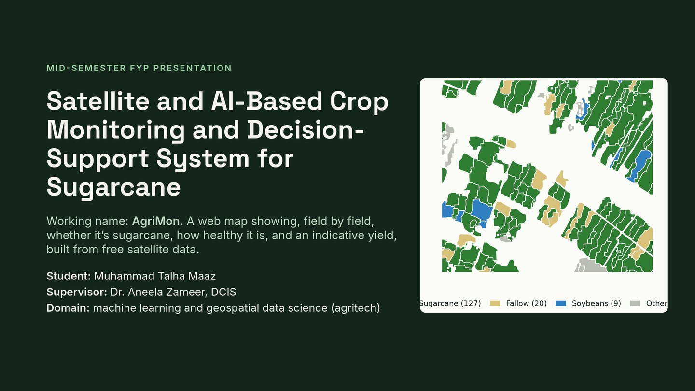

**Guideline section:** 1, Project introduction (title, members, supervisor, overview, domain).

**Every element:**
- **Title, "Satellite and AI-Based Crop Monitoring and Decision-Support System for Sugarcane":** the official title from your Form 1A. Keep it identical to the form.
  - *Decision-support* means the system helps people decide (where to look, which fields need attention). It doesn't make decisions for them.
- **Working name: AgriMon:** the short project name.
- **"A web map showing, field by field, whether it's sugarcane, how healthy it is, and an indicative yield":** the three layers P-2, P-3 and P-4 on top of P-1, the field polygons.
  - *Indicative* yield means a rough estimate, not a measured figure.
- **"built from free satellite data":** Sentinel-2, plus free US datasets.
- **Student, supervisor:** you (solo project), Dr. Aneela Zameer, DCIS.
- **Domain:** machine learning and geospatial data science (agritech).
- **The map:** real data. A 4 × 4 km patch of Iberia parish, Louisiana; each shape is one CSB field coloured by its 2023 crop: green sugarcane (127 fields), tan fallow (20), blue soybeans (9), grey other (10).

**Say (about 30 s):**
> "My project uses free satellite images and machine learning to monitor sugarcane field by field. I build and test it first where open data is rich, Louisiana in the USA, and then adapt it to Pakistan. The map is real: every shape is a field in one Louisiana parish, coloured by its 2023 crop."

**Keep in mind:**
- Don't explain the map's details here. That comes on slides 10 and 11.
- If asked "why Louisiana on the cover of a Pakistan project?", answer that it's Stage 1, and slide 7 explains why.

---

## Slide 2: Background and motivation

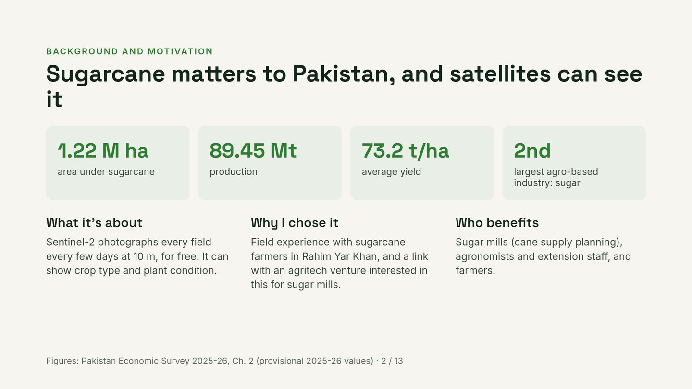

**Guideline section:** 2 (what, why chosen, real-world relevance, who benefits).

**Every element:**
- **1.22 M ha:** area under sugarcane in Pakistan, 2025-26 (provisional), from the Pakistan Economic Survey 2025-26, Chapter 2. "M ha" means million hectares; 1 ha = 10,000 m² ≈ 2.47 acres.
- **89.45 Mt:** production, million tonnes (2025-26, provisional; up 6.2 % from 84.24 Mt).
- **73.2 t/ha:** average yield, tonnes per hectare (the survey says 73,200 kg/ha, up 3.7 %).
- **2nd:** the survey calls sugar the "2nd largest agro-based" industry.
- **What it's about:** Sentinel-2 photographs every field every few days at 10 m, for free, and can show crop type and plant condition.
- **Why I chose it:** your field experience with sugarcane farmers in Rahim Yar Khan, and the agritech venture interested in this for sugar mills (both are in your Form 1A).
- **Who benefits:** sugar mills (planning cane supply), agronomists and extension staff (field advice), farmers.
- **Footer:** the source and "provisional" for the 2025-26 figures. Always say "provisional" if asked.

**Say:**
> "Sugarcane is a major crop in Pakistan: 1.22 million hectares, almost 90 million tonnes, feeding the second largest agro-based industry. Mills need to know what is growing where and in what condition. The satellite data that could tell them is free, but it doesn't reach them as field-level information."

**Keep in mind:**
- The survey also says sugarcane is 0.8 % of GDP and 3.2 % of agricultural value addition, which is useful if asked.
- If asked "how does a mill benefit?": planning cane supply (where cane is and how it's doing), spotting problem fields early, and estimating the crop. Don't promise savings figures; we have none.

---

## Slide 3: Problem statement

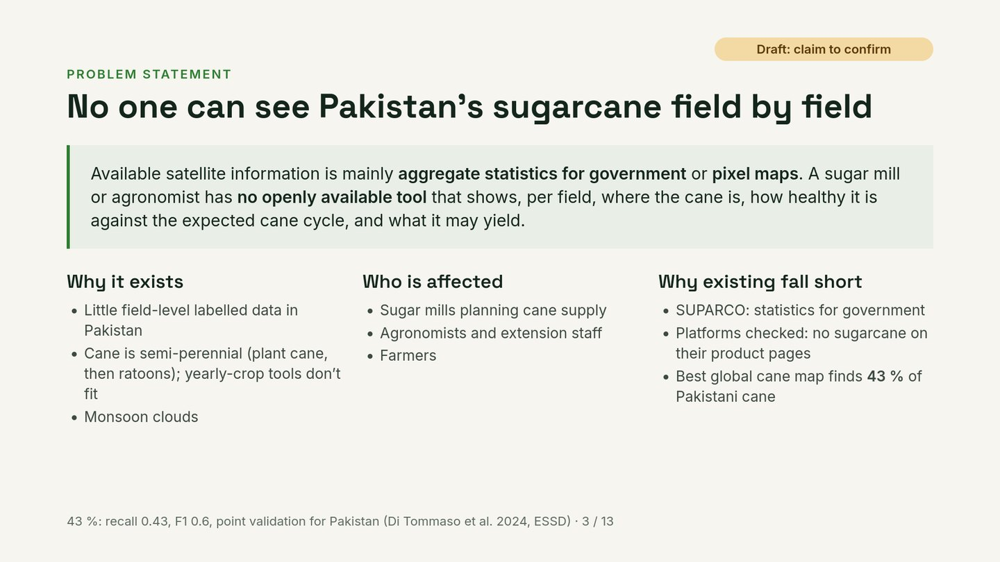

**Guideline section:** 3. The guidelines warn that the problem must be **specific**, not a general description of the field.

**Every element:**
- **The amber "Draft: claim to confirm" label:** remove it before presenting. It's there because the mill and agronomist claim comes from your experience; no source states it.
- **Title, "No one can see Pakistan's sugarcane field by field":** a recommended change, because SUPARCO did produce crop field layers (used to check 2015 subsidy claims). Safer: **"No open tool shows Pakistan's sugarcane field by field"**.
- **The statement box:** existing information is mostly aggregate statistics for government, or pixel maps. No openly available tool shows, **per field**, where the cane is, how healthy it is against the expected **cane cycle**, and what it may yield.
- **Why it exists:**
  - **Little field-level labelled data** in Pakistan: no open polygons with crop labels.
  - **Cane is semi-perennial** (plant cane, then ratoons), so tools designed for yearly crops (one crop per season) don't fit.
  - **Monsoon clouds** block optical satellites in parts of the season.
- **Who is affected:** mills, agronomists and extension staff, farmers.
- **Why existing solutions fall short:**
  - **SUPARCO:** statistics for government.
  - **Commercial platforms:** their product pages don't mention sugarcane (we only checked the pages).
  - **The best global cane map** (Di Tommaso et al. 2024) finds only 43 % of Pakistani cane in point validation: recall 0.43, F1 0.6. The reason is that no local labels were available to calibrate it; the threshold was borrowed from India.

**Say:**
> "The problem is specific: there is no open, field-level, sugarcane-aware view of Pakistan's cane. What exists is statistics for government or pixel maps. Even a peer-reviewed global sugarcane map recalls only 43 percent of Pakistani cane, because no local labels were available."

**Keep in mind:**
- **Recall 0.43** means: of the real Pakistani cane points, the map found 43 %.
- Don't say commercial tools "can't" do sugarcane. Say "their pages don't mention it".

**Likely question:** "Why can't SUPARCO's system do this?"
**Answer:** "SUPARCO's work, as described by Akhtar in a 2024 PIDE review, focuses on crop statistics for government: area, yield and production. Field-level decision support is a project in progress since 2020. I'm not claiming it's impossible; I'm building an open, field-level, sugarcane-specific version, and we've contacted SUPARCO about field data."

---

## Slide 4: Aim, objectives and scope

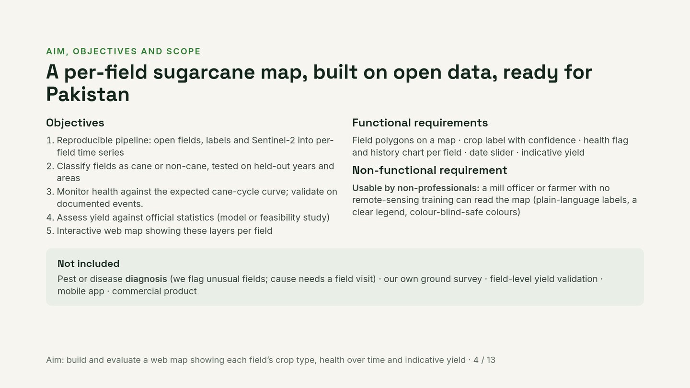

**Guideline section:** 4 (aim, 3–5 objectives, functional requirements, non-functional requirements, limitations, what's not included).

**Every element:**
- **Title:** "A per-field sugarcane map, built on open data, ready for Pakistan."
- **Objectives** (from `docs/requirements/requirements_register.md`, O1–O5):
  1. **Reproducible pipeline:** a chain of steps that turns open field polygons, labels and Sentinel-2 images into a **per-field time series** (one curve per field). *Reproducible* means anyone rerunning it gets the same result: pinned environment, fixed random seeds, recorded data versions.
  2. **Classify fields as cane or non-cane, tested on held-out years and areas:** the model is tested on years and places it never saw, which is the honest test.
  3. **Monitor health against the expected cane-cycle curve; validate on documented events:** a field is flagged when its curve departs from what's normal for its stage (plant cane or which ratoon year) and from its neighbours. "Documented events" are things like Hurricane Ida (2021) and the February 2021 freeze.
  4. **Assess yield against official statistics (model or feasibility study):** if parish yields exist we build a model; if not, a feasibility study explaining what is and isn't possible.
  5. **Interactive web map** showing all layers per field.
- **Functional requirements:** what the system **does**. Field polygons on a map · crop label with confidence · health flag and history chart per field · date slider · indicative yield. (The register has 10, R-F-01 to R-F-10.)
- **Non-functional requirement:** **how well** it must work. You chose one: **usable by non-professionals**, meaning a mill officer or farmer with no remote-sensing training can read the map (plain-language labels, a clear legend, colour-blind-safe colours). The register has 10 more (reproducibility, honest evaluation, runs on student hardware, security, licensing …) if asked.
- **Not included:**
  - **Diagnosis:** we flag unusual fields; the cause (pest, water, disease) needs a field visit.
  - **Our own ground survey:** labels come from USDA.
  - **Field-level yield validation:** only parish or state statistics exist.
  - **Mobile app** and **commercial product:** not in scope.
- **Footer:** the aim in one line.

**Say:**
> "The aim is a web map showing each field's crop type, health over time and an indicative yield. Five objectives: a reproducible pipeline, honest crop classification, cycle-aware health monitoring validated on real events, a yield assessment, and the web map. One key requirement is that non-specialists can read it. And what's not included: we flag unusual fields, we don't diagnose diseases."

**Keep in mind:**
- **"Health" is not "disease detection".** Say this clearly; examiners like the honesty.
- If asked for accuracy targets: "Targets are set after the first baselines, so I don't guess numbers now."

---

## Slide 5: Literature review, existing systems

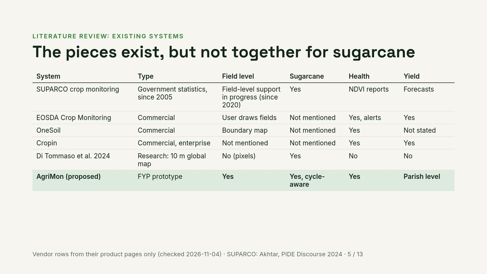

**Guideline section:** 5 (compare existing systems, their limitations, the gap, how yours differs).

**Every row:**
- **SUPARCO crop monitoring:** Pakistan's space agency. Satellite crop monitoring since 2005; the first pilot covered **Bahawalpur, Rahim Yar Khan and Ghotki** (wheat, cotton, sugarcane). Its outputs are crop statistics for government; a field-level decision-support project with PMAS Arid Agriculture University has run since 2020. Source: Akhtar, PIDE Discourse 2024. Note that the author is from SUPARCO's side of this work.
- **EOSDA Crop Monitoring:** commercial. Users draw or upload fields; 10 vegetation indices; risk alerts; yield; uses Sentinel-2 and PlanetScope. Its page doesn't mention sugarcane.
- **OneSoil:** commercial. A "global field boundaries map", crop identification, health zones. Its page doesn't mention sugarcane.
- **Cropin:** commercial, enterprise customers (250+). Crop health, yield. Its page doesn't mention sugarcane.
- **Di Tommaso et al. 2024:** a research paper with a 10 m sugarcane map of 13 countries (2019–2022). Pixels only: no fields, no health, no yield.
- **AgriMon (proposed):** fields yes, sugarcane yes and cycle-aware, health yes. Yield currently says "parish level"; change it to **"Planned (parish or state)"**, because S04 hasn't confirmed parish yields exist yet.
- **Footer:** the vendor rows come from their product pages only (checked 2026-11-04).

**Say:**
> "The pieces exist, but not together for sugarcane. SUPARCO produces statistics for government; commercial platforms are general-purpose; research maps give pixels. None that I found combines fields, sugarcane, health and yield."

**Keep in mind:**
- You haven't used these products. Say "according to their product pages".
- **"Cycle-aware"** means the system knows whether a field is plant cane or a ratoon, and compares it with the right expected curve.

---

## Slide 6: Literature review, research and the gap

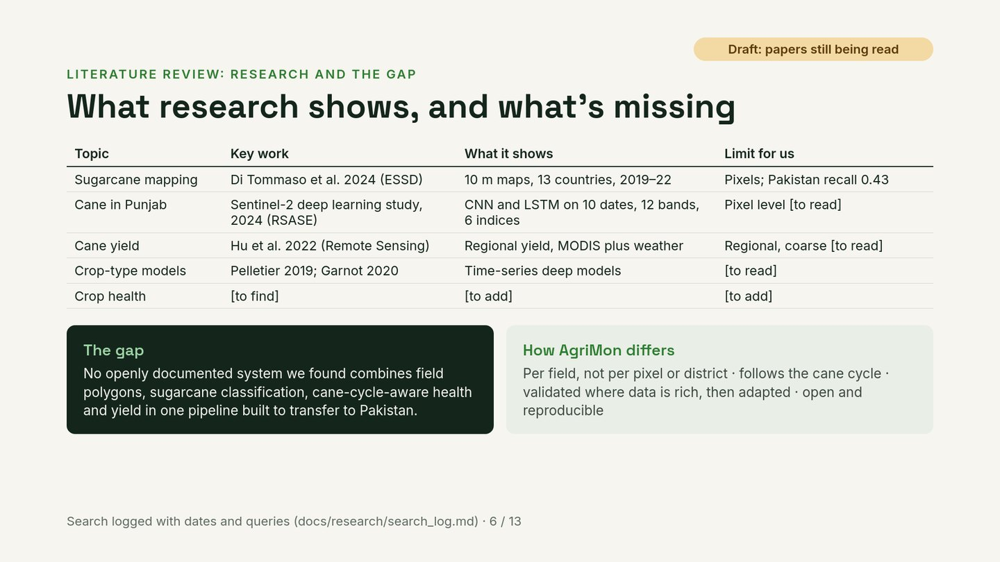

**Guideline section:** 5 (continued).

**Every element:**
- **Draft label:** papers still being read. Remove it, and the "[to read]" / "[to find]" placeholders, before presenting, either by filling them in or deleting the row.
- **Sugarcane mapping, Di Tommaso et al. 2024 (ESSD):**
  - *ESSD* is the journal Earth System Science Data.
  - Method: they used GEDI lidar to find which pixels are "tall" each month, then trained random forests on Sentinel-2 features; cane is the crop that stays tall for many months.
  - Pakistan: F1 0.6, recall 0.43 at point level; R² 0.85 against government statistics at district level.
- **Cane in Punjab, a 2024 deep-learning study** (*Remote Sensing Applications: Society and Environment*, "RSASE", article 101225):
  - Sentinel-2 L2A, 10 dates × 12 bands + 6 indices; labels from linear spectral unmixing; CNN and LSTM.
  - Pixel level. We've only seen the abstract.
- **Cane yield, Hu et al. 2022 (Remote Sensing):** regional yield for Florida and Louisiana (2008–2016) from MODIS and weather data; the SiPAR model (which includes solar radiation) worked best. Abstract only.
- **Crop-type models:** Pelletier 2019 (TempCNN) and Garnot 2020 (attention models). The standard deep models for crop time series. To read.
- **Crop health:** a gap in our review, to fill.
- **The gap** (dark box): no openly documented system we found combines field polygons, sugarcane classification, cane-cycle-aware health and yield in one pipeline built to transfer to Pakistan.
- **How AgriMon differs:**
  - per field, not per pixel or district;
  - follows the cane cycle;
  - validated where data is rich, then adapted;
  - open and reproducible.
- **Footer:** the search is logged with dates and queries (`docs/research/search_log.md`).

**Say:**
> "Research has the parts: global sugarcane maps, a Punjab pixel classifier, regional yield models, time-series deep models. The gap is that no openly documented system we found puts them together per field, cycle-aware, and designed to transfer to Pakistan."

**Keep in mind:**
- **Don't claim "nothing exists".** Say "we found none", and mention the search log.
- Don't claim better accuracy; nothing has been measured yet.
- **"Linear spectral unmixing"** estimates what fraction of a pixel is each material (cane, soil …) from its colours.

---

## Slide 7: Proposed solution and methodology

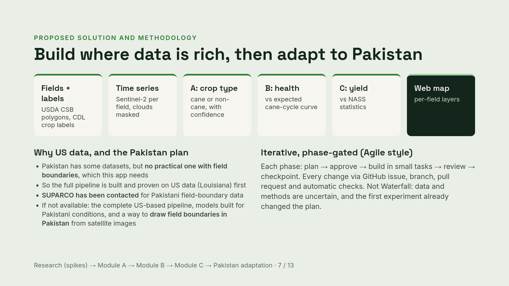

**Guideline section:** 6 (proposed solution, how it works, development methodology, workflow).

**Every element:**
- **Title:** "Build where data is rich, then adapt to Pakistan."
- **The six cards are the workflow,** left to right:
  1. **Fields + labels:** USDA CSB polygons with CDL crop labels.
  2. **Time series:** Sentinel-2 values per field over the season, with clouds masked.
  3. **A: crop type:** cane or non-cane, with a confidence value.
  4. **B: health:** compare each field with the expected cane-cycle curve (and its neighbours).
  5. **C: yield:** compared against NASS statistics.
  6. **Web map:** all layers per field.
- **Why US data, and the Pakistan plan** (your message, the most important box on this slide):
  - Pakistan has some datasets, but **no practical one with field boundaries**.
  - So the full pipeline is built and proven on US data (Louisiana) first.
  - **SUPARCO has been contacted** for Pakistani field-boundary data.
  - If that isn't possible, your contribution is: the complete US-based pipeline, models built for Pakistani conditions, and a way to **draw field boundaries in Pakistan** from satellite images.
- **Iterative, phase-gated (Agile style):**
  - each phase goes plan → approve → build in small tasks → review → checkpoint;
  - every change goes through a GitHub issue, branch, pull request and automatic checks;
  - not Waterfall, because data and methods are uncertain, and the first experiment (S01) already changed the plan.
- **Footer:** the order of work: research (spikes) → Module A → Module B → Module C → Pakistan adaptation.

**Say:**
> "I want to be clear about why I use US data. Pakistan has some datasets, but no practical one with field boundaries, which this system needs. So I build and prove the complete pipeline on US data first. We've contacted SUPARCO for Pakistani field data. If that isn't possible, my contribution is the complete pipeline, models built for Pakistani conditions, and, if possible, a method to draw field boundaries in Pakistan from satellite images."

**Keep in mind:**
- **"Phase-gated"** means a phase can't start until the previous gate (checkpoint) is passed with evidence.
- **"How did S01 change the plan?"** It showed the cane cycle (3–4 cane years, then fallow), so health must be modelled per cycle stage, not per calendar year. It also showed that in Iberia most non-cane fields are fallow, so we need a more mixed area for a fair test.
- **Drawing field boundaries is a hard research task.** Say "if possible". A known starting point is the "Fields of The World" benchmark, which we haven't read yet.

---

## Slide 8: Expected architecture and use cases

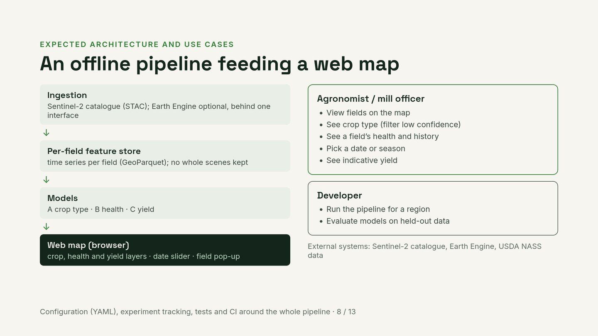

**Guideline section:** 6 (expected architecture, SE diagrams).

**Every element (left: the architecture, top to bottom):**
- **Ingestion:** getting images in. The Sentinel-2 catalogue (STAC) by default, with Earth Engine as an optional alternative. **"Behind one interface"** means the rest of the code doesn't know which source is used, so it can be swapped by configuration (important because GEE's free tier is noncommercial).
- **Per-field feature store:** for each field, its time series of band values and indices, saved as GeoParquet files. **"No whole scenes kept"**: we stream images and keep only per-field numbers. That saves disk and is a project rule.
- **Models:** A (crop type), B (health), C (yield).
- **Web map (browser):** crop, health and yield layers, a date slider, and a pop-up when you click a field.

**Right: the use cases (who does what):**
- **Agronomist or mill officer:** view fields; see crop type (and filter out low-confidence ones); see a field's health and history; pick a date or season; see indicative yield.
- **Developer (you):** run the pipeline for a region; evaluate models on held-out data.
- **External systems:** the Sentinel-2 catalogue, Earth Engine, USDA NASS data.

**Footer:** configuration files (YAML), experiment tracking, tests and CI surround the whole pipeline.

**Say:**
> "The pipeline runs offline: images come in through one interface, each field gets its time series, three models run on it, and the results feed a web map. The user is an agronomist or mill officer reading the map; I'm the developer running and evaluating the pipeline."

**Keep in mind:**
- **"Offline pipeline"** means processing runs as scheduled jobs, not live on every click. The map shows the latest results.
- **If asked for an ERD or database design:** there's no database server. The core is one per-field table:
  - field id;
  - geometry;
  - crop label per year;
  - index time series;
  - prediction;
  - confidence;
  - health flag.
- **"Use-case diagram"**: the guidelines ask for one. This text version counts; you can redraw it as a UML diagram with stick figures if you have time.

---

## Slide 9: Technologies and tools

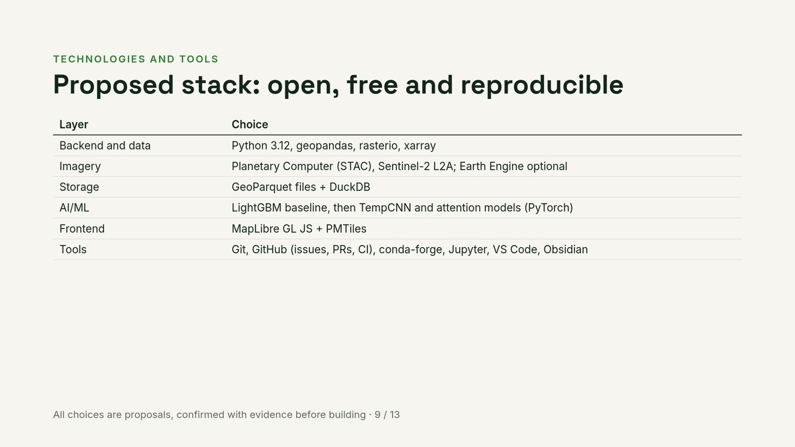

**Guideline section:** 7 (frontend, backend, database, AI/ML, algorithms, tools, plus brief justification).

**Every row and why it's there.** The reasons aren't on the slide; say them out loud:

| Layer | Choice | Why (say this) |
|---|---|---|
| Backend and data | Python 3.12, geopandas, rasterio, xarray | The standard geospatial stack; already used in S01 and S02 |
| Imagery | Planetary Computer (STAC), Sentinel-2 L2A; Earth Engine optional | Free, open catalogue; GEE optional because its free tier is noncommercial |
| Storage | GeoParquet files + DuckDB | Per-field tables are small; no server to run; files make results reproducible |
| AI/ML | LightGBM baseline, then TempCNN and attention models (PyTorch) | The standard "model ladder" for crop time series: start simple, add complexity only if it helps; fits a 6 GB GPU |
| Frontend | MapLibre GL JS + PMTiles | Open-source web maps, no API key, no backend server |
| Tools | Git, GitHub (issues, PRs, CI), conda-forge, Jupyter, VS Code, Obsidian | Reviewable history, pinned environment, documentation |

**Footer:** "All choices are proposals, confirmed with evidence before building."

**Keep in mind:**
- **Why no MySQL or MongoDB?** "Because the data is per-field tables that are written once by the pipeline and read by the map. Files are simpler and reproducible. A live multi-user product would need a database server; that's a later decision."
- **Why Python 3.12, not the newest?** Some geospatial packages aren't ready for 3.14 yet.
- **Model ladder:**
  - Majority class or a rule.
  - **LightGBM:** boosted trees.
  - **TempCNN:** a time convolution network.
  - **Attention:** learns which dates matter.
- Each step must beat the one before, or we stop.

---

## Slide 10: Datasets selected, why these

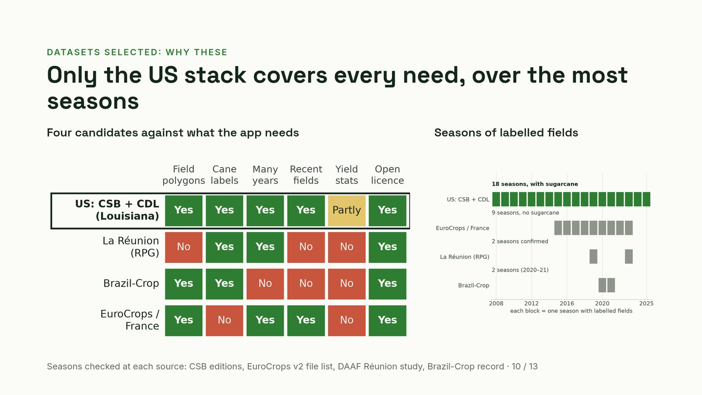

**Guideline section:** 8 (preliminary work), plus the evidence behind the dataset choice.

**Left: the coverage matrix** (four candidates × six needs):

| Need | What it means |
|---|---|
| Field polygons | real field shapes (P-1) |
| Cane labels | sugarcane is a labelled class (P-2) |
| Many years | several seasons, for honest testing and health baselines |
| Recent fields | polygons up to a recent year, for the present-day health layer |
| Yield stats | yield statistics for the same area |
| Open licence | allows thesis use and published maps |

- **US: CSB + CDL:** Yes everywhere except yield, which is **Partly**: state-level yields are confirmed, parish level is being checked (S04).
- **La Réunion:** No for field polygons, recent fields and yield stats. In the notes, "No" means we couldn't confirm it was available to us.
- **Brazil-Crop:** No for many years (only 2 seasons), recent fields and yield stats.
- **EuroCrops / France:** No for cane labels (no sugarcane) and yield stats; open licence **Yes** (CC BY 4.0, verified).

**Right: seasons of labelled fields.** Each block is one season with labelled fields:
- US: 2008–2025, **18 seasons, with sugarcane**;
- EuroCrops France: 2015–2023, 9 seasons, no sugarcane;
- La Réunion: 2 seasons confirmed (2019, 2023);
- Brazil-Crop: 2 seasons (2020–21).

**Footer:** each span was checked at its source (CSB editions, the EuroCrops v2 file list, the DAAF Réunion study, the Brazil-Crop record).

**Say:**
> "I compared four candidates against what the app needs. Only the US stack covers everything we could check, and it has 18 seasons of labelled fields, all with sugarcane. Many seasons matter for two reasons: honest testing means testing on years the model never saw, and the health layer needs many years to learn what a normal season looks like."

**Keep in mind:**
- **If asked "is a 'No' for La Réunion certain?":** "No. It means we couldn't confirm it was available to us. Parcel-level access for the island was never verified."
- **If asked about label quality:** "USDA's own check puts sugarcane accuracy in Louisiana at about 94–95 % of real cane found, and 96 % of cane labels correct, per pixel, against farmer-reported data."
- **If asked "why Louisiana and not Florida?":**
  - Louisiana has the most cane fields: 32,373 in 2023, in 32 parishes. Florida has 16,981 in 11 counties.
  - In Louisiana's main cane parishes, 28 % of fields are other field crops (soybeans, rice, corn), against none in Florida's main cane counties. So the model must tell cane from other real crops, which is closer to Pakistan.
  - Louisiana also has documented hurricanes and the 2021 freeze to test the health layer against.

---

## Slide 11: Initial progress

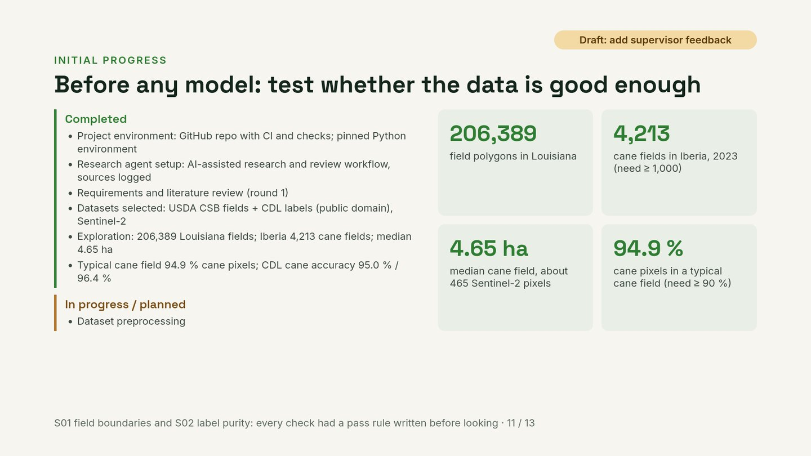

**Guideline section:** 8 (what's actually done; **clearly separate completed from planned**, which the guidelines mark in red). Must match your attendance sheet.

**Every element:**
- **The Draft label:** add your supervisor meetings and feedback (required by the guidelines), then remove the label.
- **Completed:**
  - **Project environment:** GitHub repository with CI and checks (tests, lint, secret scan, protected `main`); a pinned Python environment (conda-forge, exact versions in a lock file).
  - **Research agent setup:** an AI-assisted research and review workflow (Claude Code with read-only agents: dataset-scout, reviewer, examiner; a literature-review command), with every search logged.
  - **Requirements and literature review (round 1):** the product spec, requirements register, existing-systems review.
  - **Datasets selected:** USDA CSB fields + CDL labels (public domain), and Sentinel-2 imagery.
  - **Exploration:** 206,389 Louisiana fields; 4,213 cane fields in Iberia; median cane field 4.65 ha.
  - **Typical cane field is 94.9 % cane pixels;** CDL cane accuracy 95.0 % (producer's) / 96.4 % (user's) for Louisiana 2023.
- **In progress / planned:** currently just "Dataset preprocessing". Add:
  - **Earth Engine:** installed and logged in; project link pending. It's on your attendance sheet.
  - **Sentinel-2 access and cloud cover (S03).**
  - **Parish yields (S04).**
  - **Literature round 2.**
- **The four tiles:**
  - **206,389:** field polygons in Louisiana (CSB 2018–2025).
  - **4,213:** cane fields in Iberia in 2023, against a pass rule of at least 1,000.
  - **4.65 ha:** median cane field, about 465 Sentinel-2 pixels, against a rule of at least 0.5 ha.
  - **94.9 %:** cane pixels in a typical cane field, against a rule of at least 90 %.
- **Footer:** S01 checked the field boundaries and S02 the label purity. Every check had a pass rule written before looking.

**Say:**
> "Before building any model, I tested whether the data is good enough, and every check had a pass rule written before looking. Plenty of fields, fields big enough for the satellite to see, and cane fields that really are cane: about 95 percent of their pixels, and 100 percent one pixel in from the edge."

**What S01 and S02 found (be ready to explain):**
- **S01 (field boundaries):**
  - the national CSB file was cut down to Louisiana, and Iberia was chosen;
  - no field is missing a label in any of the 8 years;
  - the stated areas match the geometry;
  - the cane cycle is visible: the top sequences are `CCCCFCCC` and `CCCFCCCC`, where C = cane and F = fallow;
  - in Iberia, most non-cane fields are fallow cane land.
- **S02 (label purity):**
  - the CDL raster lines up with the CSB polygons;
  - the CSB label matches our own pixel count for 99.5 % of fields;
  - 94.9 % of cane fields are at least 70 % cane;
  - after shrinking fields by 30 m the median purity is 1.000, so the impurity is at the edges;
  - 87.3 % of CDL cane pixels fall inside CSB fields.

**Keep in mind:**
- **99.5 % agreement isn't proof of truth.** Both products come from the CDL, so agreement is expected. The truth evidence is USDA's FSA-based accuracy.
- **Pass rules were set in advance.** That's your strongest methodological point on this slide.

---

## Slide 12: Timeline and future plan

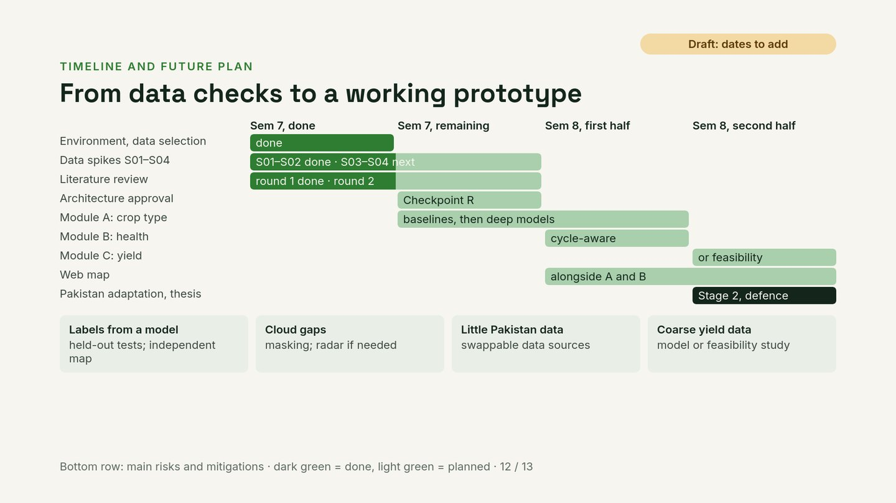

**Guideline section:** 9 (work done, remaining tasks this semester, deliverables next semester, Gantt chart, risks).

**Every element:**
- **The Draft label:** add your dates to the column headings, then remove it.
- **Columns:** Semester 7 done · Semester 7 remaining · Semester 8 first half · Semester 8 second half.
- **The bars** (dark green = done, light green = planned):
  - **Environment, data selection:** done.
  - **Data spikes S01–S04:** S01–S02 done, S03–S04 next.
  - **Literature review:** round 1 done, round 2 next.
  - **Architecture approval (Checkpoint R):** remaining this semester. This is the formal sign-off on the architecture, with evidence for each choice.
  - **Module A (crop type):** baselines, then deep models, from the end of semester 7 into semester 8.
  - **Module B (health):** cycle-aware, semester 8 first half.
  - **Module C (yield):** a model or a feasibility study, semester 8 second half.
  - **Web map:** built alongside A and B.
  - **Pakistan adaptation and thesis:** Stage 2 and the defence, at the end.
- **The risks** (bottom row):
  - **Labels come from a model** (circularity) → held-out tests, plus comparison with an independent map (Di Tommaso 2024).
  - **Cloud gaps** → cloud masking; Sentinel-1 radar if needed.
  - **Little Pakistan data** → swappable data sources; SUPARCO request; field-boundary drawing as the fallback.
  - **Coarse yield data** → a model or a feasibility study.

**Say:**
> "This semester: finish the data spikes, the second round of literature and the architecture approval, and start the crop-type baselines. Next semester: the crop model, then health, yield, and the web map alongside, then the Pakistan adaptation and the thesis."

**Keep in mind:**
- Other risks to mention if asked:
  - a 6 GB GPU, so simple models first, and Colab or Kaggle for heavy training;
  - Earth Engine's noncommercial terms, so it stays optional;
  - a solo project with broad scope, so health (B) is prioritised over yield (C).
- **The Form 1A planned more for semester 7** (modules developed and tested). You said you'll defend that. Keep your answer ready.

---

## Slide 13: Thank you and questions


**Keep in mind:**
- The deck is **13 slides; the guidelines say 10–12**. Drop this slide, or merge slides 5 and 6, if you want to be strictly inside the rule.
- The likely questions are in Part 7.

---

# PART 6: The architecture and plans in depth

## 6.1 Phase R: how the design gets decided

```
 design questions (DQ-01 … DQ-23)          "what must the architecture answer?"
        │
 hypotheses (H-01 … H-24)                  the kit's starting guesses, each
        │                                  marked hypothesis / provisional /
        │                                  validated / rejected
        ▼
 literature (search log, paper notes)  +   spikes (S01, S02, S03, S04 …)
        │                                  small experiments with pass rules
        ▼
 synthesis + architecture dossier + ADRs   each choice: options, evidence, risk
        │                                  ADR = Architecture Decision Record
        ▼
 CHECKPOINT R  (you approve)  ──►  Phase 0 (repo scaffold) ──► Module A ...
```

**The design questions that matter most right now:**

| DQ | Question | Status |
|---|---|---|
| DQ-01 | Which country and data stack covers P-1 to P-4? | US stack and Louisiana chosen; ADR at Checkpoint R |
| DQ-05 | Unit of classification: pixel, field or patch? | Field (CSB) favoured, supported by S01 |
| DQ-10 | How to split data so scores are honest? | Planned: held-out years and areas |
| DQ-14 | Binary or multi-class? | Open; S01 note: in Iberia "non-cane" is mostly fallow |
| DQ-18 | What does "health" mean, and which signals carry it? | Open; literature gap |
| DQ-21 | How to handle the sugarcane cycle? | S01 shows the cycle in real data |
| DQ-22 | What yield data exist? | State level confirmed; parish level is S04 |
| DQ-23 | Fields for a recent season? | CSB reaches 2025 (H-23) |

**Hypotheses with evidence so far:**
- **H-24:** CDL labels on CSB fields are accurate enough. Status *provisional*, with S01, S02 and the NASS accuracy figures as evidence.
- **H-20:** sugarcane can be treated like a yearly crop. Expected to **fail**, as the S01 cycle shows.
- **H-23:** reuse the labelled fields for a recent season. Supported by the CSB reaching 2025.

## 6.2 Module A: crop type (first deliverable)

```
 CSB fields (Iberia, years)  ─┐
                              ├─► per-field Sentinel-2 time series ─► features
 CDL labels per year         ─┘      (inner buffer, cloud mask)        (bands,
                                                                        indices
                                                                        per date)
        ▼
 baselines: majority · NDVI rule · LightGBM
        ▼
 deep models: TempCNN · attention      (only if they beat the baseline)
        ▼
 evaluation: train on some years/areas, test on held-out ones;
             per-class precision/recall/F1, confusion matrix, several seeds
        ▼
 calibrated confidence ─► map layer "crop type"
```

## 6.3 Module B: health (the module you care most about)

```
 for each field: its index curve this season
        │
        ├─ compare with the EXPECTED curve for its cycle stage
        │    (plant cane vs ratoon year; from many past seasons)
        ├─ compare with its NEIGHBOURS this season
        │    (if everyone dropped, it's probably weather, not this field)
        └─ context: weather, soil moisture, (radar under cloud)
        ▼
 health flag + history chart          validated on documented events:
                                      Hurricane Ida 2021, Feb 2021 freeze,
                                      Hurricanes Delta 2020, Francine 2024
```

**The honest framing:** "Health" means **departure from expected growth**, not disease diagnosis.

## 6.4 Module C: yield

- **The data decides:** parish yields (if S04 finds them) → a regional model compared against NASS statistics; only state yields → a feasibility note.
- **A related idea:** the cane cycle gives a free label (plant cane vs ratoon), and ratoon yields usually decline, which still needs confirming in the literature.

## 6.5 The web map

- **MapLibre GL JS + PMTiles:** static, with no server and no API key.
- **Layers:** crop type, health, yield.
- **Interaction:** a date slider; a pop-up with the crop and confidence, the health chart and the yield.
- **Demo:**
  - **Tier 1 (must):** a replay on past fields.
  - **Tier 2 (stretch):** a run on present-day fields.

## 6.6 Stage 2: Pakistan

| Path | When | What |
|---|---|---|
| A | SUPARCO provides field boundaries | Build the Pakistan version on them |
| B | No field boundaries | US pipeline + models built for Pakistani conditions (using existing Pakistani data, e.g. per-field time series) + if possible, a method to draw field boundaries from satellite images |

What will differ in Pakistan:
- smallholder fields, much smaller than Louisiana's 4.65 ha median;
- monsoon clouds, so radar may be needed;
- different crop calendars;
- scarce labels.

## 6.7 The engineering workflow

```
 GitHub issue ─► branch ─► commits (Conventional Commits) ─► push ─► draft PR
      ─► CI checks (tests, lint, CodeQL, PR title) ─► you review ─► you merge
 hooks block: push to main · merges by the agent · force pushes · committing data or secrets
```

---

# PART 7: Question bank (with answers)

| Question | Answer |
|---|---|
| Why the US and not Pakistan first? | "Pakistan has no practical open dataset with field boundaries, which a field-level system needs. I build and prove the full pipeline where such data exists, and we've contacted SUPARCO for Pakistani field data." |
| Your labels come from a model. How do you know they're right? | "USDA checks the CDL against farmer-reported data: about 95 % of real cane found and 96 % of cane labels correct in Louisiana. I also checked purity myself: a typical cane field is 95 % cane, 100 % away from edges. I'll compare with an independent sugarcane map too." |
| Isn't that circular? | "Partly, yes: the CDL itself uses Sentinel-2. I state it openly, test on held-out years and areas, and compare against an independent map that wasn't trained on the CDL." |
| How is this different from SUPARCO or EOSDA? | "SUPARCO produces statistics for government; EOSDA and others are general platforms whose pages don't mention sugarcane. Mine is per field, sugarcane-specific and cycle-aware, open, and designed to transfer to Pakistan." |
| What does "health" mean if you can't diagnose disease? | "A field behaving differently from what's expected for its stage and from its neighbours. It tells someone where to look; the cause needs a field visit." |
| Why no database? | "Per-field tables written once by the pipeline: files are simpler and reproducible. A multi-user live product would add a database later." |
| What's your accuracy? | "Nothing is measured yet; targets are set after baselines. I've measured the data quality first." |
| Why Louisiana and not Florida? | "Twice the cane fields (32,373 vs 16,981), and cane grows among other crops (28 % soybeans, rice and corn in the main parishes), so it's a fairer test and closer to Pakistan." |
| How will you handle clouds? | "Cloud masking with Sentinel-2's scene classification; radar if needed. That's the next spike." |
| What if SUPARCO says no? | "Then my contribution is the full pipeline, models for Pakistani conditions, and if possible a method to draw field boundaries from satellite images." |
| Why does the plan differ from your Form 1A? | (Your answer. Form 1A planned real-field validation in Rahim Yar Khan, a decision-support alert layer, and modules tested in semester 7; the current plan uses open data in Stage 1 and adapts to Pakistan in Stage 2.) |
| How do you split data honestly? | "Train on some years and areas, test on others. Random splits put neighbouring fields in both sets, which makes scores look too good." |
| What is NDVI? | "A greenness index: (NIR − Red)/(NIR + Red). Healthy plants reflect a lot of near-infrared and absorb red." |
| What's a ratoon? | "Cane regrowing from the stubble after harvest. Louisiana fields usually run 3–4 cane years, then fallow, then replanting." |
| How big are the fields? | "Median cane field in Iberia is 4.65 ha, about 465 Sentinel-2 pixels; Pakistan's are much smaller, which is a Stage 2 challenge." |
| What did you actually build so far? | "The environment and workflow, the dataset search and choice, two data experiments with real data (S01, S02), the literature and existing-systems review, the requirements and the architecture." |
| Is Earth Engine allowed? | "Its free tier is for noncommercial research; I use it only for university work and keep it optional behind an interface." |
| What does AI do in your workflow? | "Claude Code is my development and research assistant, and its searches and sources are logged. The university allows full AI use but requires me to understand everything, and this guide is part of that." |

---

# PART 8: Honest weaknesses (and how to talk about them)

| Weakness | How to say it |
|---|---|
| Labels are model output, not ground truth | "Stated openly; accuracy is published by USDA; independent check planned" |
| Circularity (CDL uses Sentinel-2) | "Known; tested on held-out years and areas; independent map comparison" |
| CSB fields are approximate (smoothed, merged) | "Good enough for a prototype; their creation method is documented by NASS" |
| One parish, one year checked for purity | "Other years and a second, more mixed parish are next" |
| In Iberia, non-cane is mostly fallow | "Which is why a second, more mixed parish is planned for a fair test" |
| Literature only partly read | "Round 2 in progress; the reading depth is recorded for each source" |
| No accuracy results yet | "By design: data quality first, then baselines" |
| Behind the Form 1A's semester-7 goals | (your defence) |
| Louisiana isn't Pakistan | "Stage 1 is for proving the pipeline; the Pakistan differences are listed and planned for" |

---

# PART 9: Numbers cheat-sheet

| Number | What | Source |
|---|---|---|
| 1.22 M ha · 89.45 Mt · 73.2 t/ha | Pakistan sugarcane 2025-26 (provisional) | Pakistan Economic Survey 2025-26 |
| 0.8 % · 3.2 % | Sugarcane share of GDP · of agricultural value addition | same |
| 0.43 · 0.6 | Di Tommaso 2024 Pakistan recall · F1 | ESSD 16:4931 |
| 2005 · 2020 | SUPARCO monitoring start · field-level DSS project start | PIDE 2024 |
| 15,973,095 | CSB fields, contiguous US (2018–2025) | CSB file |
| 206,389 | Louisiana fields | S01 |
| 32,373 | Louisiana cane fields 2023 (Florida 16,981; Texas 1,413) | national CSB |
| 5,632 · 4,213 | Iberia fields · cane fields 2023 | S01 |
| 3,963–4,213 | Iberia cane fields per year 2018–2025 | S01 |
| 4.65 ha ≈ 465 pixels | Median Iberia cane field | S01 |
| 94.9 % · 1.000 · 87.3 % | Median cane purity · after −30 m buffer · CDL cane inside CSB | S02 |
| 99.5 % | CSB label = our pixel majority | S02 |
| 94.1–95.0 % · 95.8–96.4 % | CDL Louisiana sugarcane producer's · user's accuracy | NASS metadata |
| 18 · 9 · 2 · 2 | Seasons: US · EuroCrops France · Réunion confirmed · Brazil-Crop | sources checked |
| 3.76 GB · 2.06 GB | CSB · CDL downloads | NASS |

---

# PART 10: Before you present (checklist)

- [ ] **Slide count:** 13 → drop slide 13 or merge 5 and 6 (the guidelines say 10–12).
- [ ] **Remove all amber "Draft" labels** (slides 3, 6, 11, 12).
- [ ] **Slide 3 title:** "No open tool shows Pakistan's sugarcane field by field".
- [ ] **Slide 5:** AgriMon yield → "Planned (parish or state)".
- [ ] **Slide 6:** fill or remove "[to read]" / "[to find]".
- [ ] **Slide 11:** add Earth Engine (on your attendance sheet), S03/S04, and supervisor meetings and feedback.
- [ ] **Slide 12:** add the dates.
- [ ] **Bring** the printed attendance or progress sheet, and check every item on it appears in the slides.
- [ ] **Link Earth Engine to your Cloud project,** so it counts as done.
- [ ] **Timed run-through under 10 minutes** (aim for 9). Then one rehearsal with `/viva-drill`.
- [ ] **Read this guide's Parts 7 and 8** the night before.
