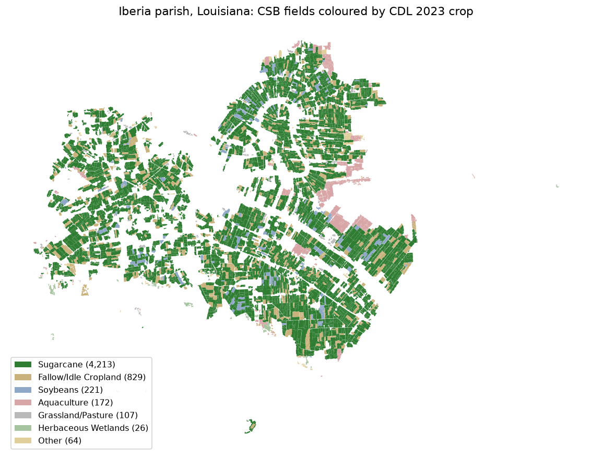
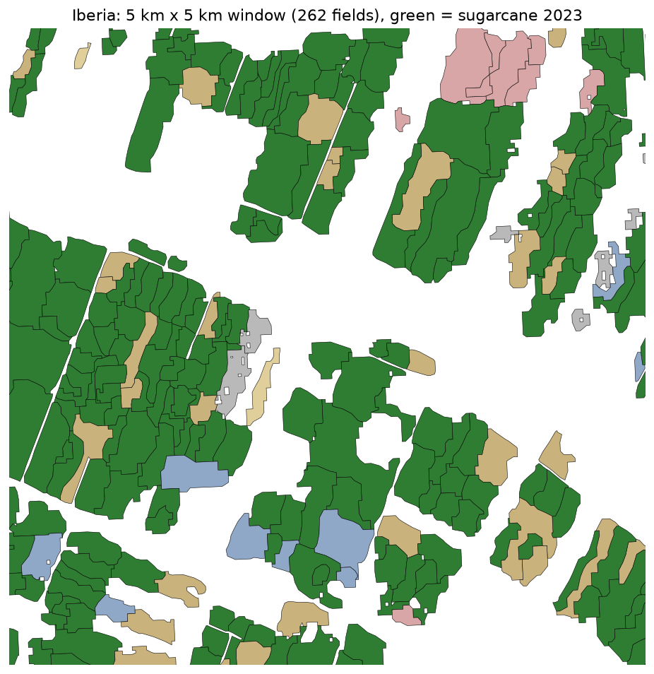
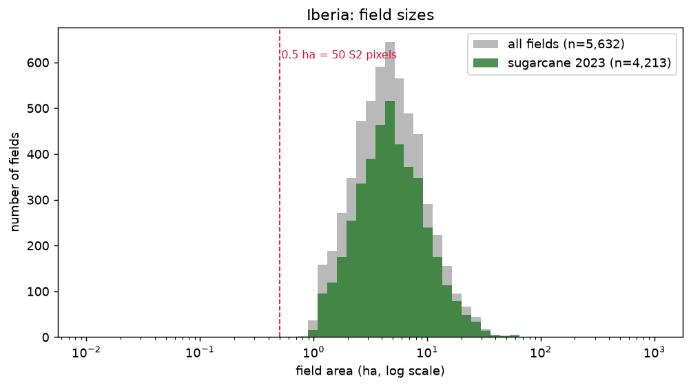
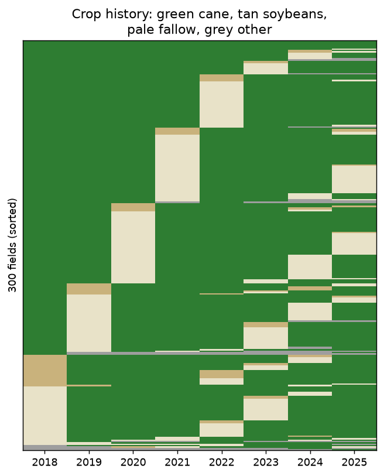

# S01: CSB field boundaries in a Louisiana sugarcane parish (2026-10-27)

Notebook: `notebooks/exploration/01_csb_fields.ipynb`. Issue #30. Dataset note: [usda_csb](../datasets/usda_csb.md).

## Question and decision rule (stated before looking)

Are the USDA Crop Sequence Boundaries (2018-2025 edition) usable as field polygons (P-1) and per-year labels (P-2) for the study area? Adopt CSB for the study parish if:

1. at least 1,000 sugarcane fields in every year 2018-2025;
2. the median cane field covers at least 50 Sentinel-2 10 m pixels (0.5 ha);
3. every field carries a crop code for all eight years.

## Observations

- Louisiana: 206,389 CSB fields; 32,373 sugarcane fields in 2023 (604,492 acres). Sugarcane fields per year across the state: 29,655 (2018) to 32,373 (2023), 30,865 in 2025.
- **Study parish: Iberia**, the most cane fields in 2023 (4,213). Pointe Coupee has the most cane acres (81,539) with larger fields (median 15.3 acres vs 11.5).
- Iberia has 5,632 fields (34,241 ha). 2023 classes:

  | Class | Fields |
  |---|---|
  | Sugarcane | 4,213 |
  | Fallow/idle | 829 |
  | Soybeans | 221 |
  | Aquaculture | 172 |
  | Grassland/pasture | 107 |
  | Other | fewer than 30 each |

- Sugarcane fields per year in Iberia: 3,963 to 4,213.
- Field size:
  - Cane fields have a median of 4.65 ha (about 465 Sentinel-2 pixels); the 10th percentile is 1.97 ha and the 90th is 11.77 ha.
  - No field is under 0.5 ha.
- **Labels:** every field has a non-zero code in all 8 years.
- **Area check:** the stated acres match the geometry area (median ratio 1.0000).
- **CRS:** Albers Conic Equal Area on NAD83, in metres.
- **Crop histories:**
  - 5,372 Iberia fields grew cane in at least one year.
  - Most grew cane in 6 of the 8 years (2,925 fields) or 7 (1,775); only 99 were cane all 8 years.
  - The top sequences are 3–4 cane years, one fallow year, then cane again (for example `CCCCFCCC` 429 fields, `CCCFCCCC` 425; C = cane, F = fallow).
- **Shapes:** in the 5 km zoom, field outlines are smooth and irregular, often blob-like rather than rectangular.

Figures:

## Interpretation

- **All three decision rules pass.** CSB is adopted, provisionally, as the polygon and label source for Iberia. The adoption becomes final in the DQ-01 ADR at Checkpoint R.
- **The crop histories show the expected cane cycle:** plant cane, two or three ratoon crops, one fallow year, replant. This supports treating sugarcane by cycle stage rather than as an annual crop (DQ-21; H-20 is expected to fail). It also gives a free label: the year after a fallow year is plant cane.
- **In Iberia, "non-cane" is mostly fallow cane land.** Of the 1,419 non-cane fields in 2023, 829 were fallow, and many of those are part of the cane cycle. So a binary cane vs non-cane model here mostly learns "cane vs bare or fallow field", which is likely easy. That makes binary attractive for the product (DQ-14), but it is a weaker test of crop discrimination. A harder second area with more soybeans and rice (Pointe Coupee, or St. Landry) would test it properly.
- **The boundaries are derived from pixels, not surveyed.** The metadata confirms it: no manual drawing, polygons under 1 ha merged into neighbours, outlines simplified at 60 m tolerance. That explains the smooth blob outlines and the missing small fields. A CSB "field" may merge several real fields that share a history. Acceptable for a prototype; to state in the thesis.
- **Fields are large relative to 10 m pixels.** About 465 pixels per median field, so edge pixels are a small share. Pakistan's fields are much smaller; noted for Stage 2.

- **The CDL itself uses Sentinel-2** (and Landsat), per the CSB metadata. The circularity risk (H-24) is therefore direct: our Sentinel-2 model learns labels from a Sentinel-2-based classifier.

## Decision

- Use CSB 2018-2025 for Iberia as the Stage 1 field polygons and labels (provisional, linked to DQ-01, DQ-05, H-23).
- S02 checks label purity per field against the CDL raster (H-24).
- DQ-14 gets a new note: in cane-dominated parishes, "non-cane" is mostly fallow. Consider a second, more mixed parish for a harder test.

## Check questions

1. Why do we compute field areas in the Albers CRS rather than in longitude and latitude?
2. A field reads `CCCFCCCC`. What happened in 2021, and what was probably planted in 2022?
3. Why might a binary cane vs non-cane classifier look better in Iberia than it really is?
