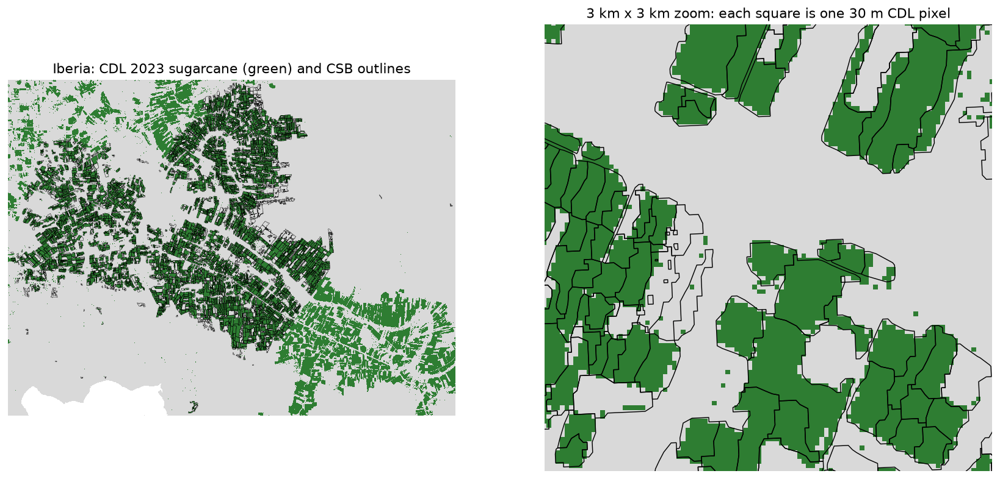
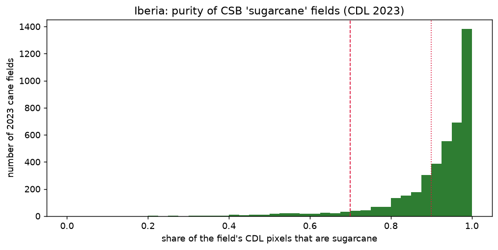

# S02: how pure are CSB "sugarcane" fields? (CDL 2023, Iberia, 2026-11-06)

Notebook: `notebooks/exploration/02_cdl_labels.ipynb`. Issue #30. Dataset notes: [usda_cdl](../datasets/usda_cdl.md), [usda_csb](../datasets/usda_csb.md).

## Question and decision rule (stated before looking)

A CSB field's `CDL2023` value is the majority CDL class inside it. How much of a "cane" field is cane pixel by pixel, and how much CDL cane lies outside CSB fields? Adopt the CSB majority labels as Module A training labels for Iberia if:

1. the median cane share in 2023 cane fields is at least 0.90;
2. at least 90 % of cane fields have a cane share of at least 0.70;
3. at least 80 % of the parish's CDL cane pixels are inside CSB fields.

## Observations

- **Alignment:**
  - The CDL 2023 raster is 153,811 × 96,523 pixels at 30 m, `uint8`, CRS NAD83 / Conus Albers.
  - It has the same CRS as the CSB, so no reprojection was needed.
  - The Iberia window is 1,218 × 1,619 pixels, read as a 2 MB array instead of the 3.2 GB file.
  - In the zoom, CDL cane pixels sit inside the CSB outlines.
- **Every Iberia field (5,632) has at least one pixel,** using pixel-centre assignment.
- **Labels agree:** the CSB's `CDL2023` equals our own pixel-majority class for **99.5 %** of fields.
- **Purity of the 4,213 cane fields (2023):**

  | Measure | Value |
  |---|---|
  | Median cane share | 0.949 |
  | 25th percentile | 0.889 |
  | 10th percentile | 0.792 |
  | Fields with share ≥ 0.70 | 94.9 % |
  | Fields with share ≥ 0.90 | 71.5 % |

- **Edge effect:** after shrinking every field by 30 m (one pixel), 4,034 cane fields remain. Their median share rises from 0.949 to **1.000**, and the share of fields at ≥ 0.70 rises from 94.9 % to 96.8 %.
- **What the impure pixels are,** for non-cane pixels inside cane fields:

  | Class | Share of those pixels |
  |---|---|
  | Fallow/idle | 30.5 % |
  | Grassland/pasture | 24.9 % |
  | Soybeans | 12.8 % |
  | Developed (low, open, medium intensity) | 23.5 % in total |

- **Fallow fields (829):** median cane share 0.078; 6.6 % contain more than 30 % cane.
- **Coverage:** of 314,363 CDL cane pixels in the parish area (the convex hull of its fields), **87.3 %** fall inside a CSB field.

## Interpretation

- **All three rules pass.** The CSB majority labels are adopted, provisionally, as the 2023 training labels for Iberia (H-24).
- **Impurity is mostly at the edges.** One pixel inside the boundary, the typical cane field is pure. Edge pixels are mixed with headlands, grass margins and roads (the "developed" pixels). So Module A should apply an **inner buffer** (for example −10 to −30 m) before averaging Sentinel-2 pixels. That's a candidate setting for design study DS-A-05.
- **Fallow and grassland inside cane fields** are likely a mix of real field margins and the CDL confusing cane with bare or grassy cover early in the season. They can't be separated with these data.
- **The 12.7 % of cane pixels outside CSB fields** are probably small or edge areas that NASS's polygon rules merged away. The cane area measured from CSB fields slightly underestimates the CDL's cane area, so this matters for any area statistic (Olofsson 2014, to be read).
- **This is agreement, not accuracy.** Both products come from the same CDL, so 99.5 % agreement is expected. Truth-side evidence is still the CDL's FSA-based accuracy (94–96 % for sugarcane in Louisiana) and, later, an independent map (Di Tommaso 2024).

## Decision

- Use CSB 2023 labels for Iberia, with an inner buffer before extracting pixels. The buffer size is to be tested in S03 and Module A.
- An optional purity filter (for example, keep cane fields with share ≥ 0.7) goes into DQ-10 as a sensitivity check, not a default.
- The per-field purity table is saved as `data/interim/csb/iberia_cane_purity_2023.parquet`.

## Check questions

1. Why does 99.5 % agreement between CSB and CDL not prove that the labels are correct?
2. Why did purity rise to 1.0 after the −30 m buffer, and what does that tell us to do with Sentinel-2 pixels?
3. A field is 3.5 acres. About how many 30 m CDL pixels does it have, and how many 10 m Sentinel-2 pixels?
